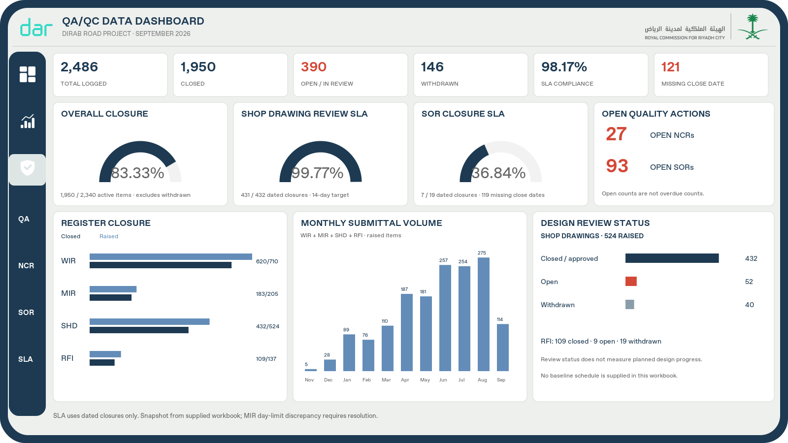

# DIRAB QA/QC dashboard projects

**Simplified HSE (latest):** [Download Dirab-HSE-Three-Pages.zip](Dirab-HSE-Three-Pages.zip). Exactly three HSE pages: your existing HSE unchanged, NCR cards/monthly backlog/type charts, and incident/safety cards with the three requested trend charts. Extract, open the PBIP with PBIR disabled, refresh, then save as PBIX.

**HSE extension:** [Download Dirab-HSE-Extension-Legacy.zip](Dirab-HSE-Extension-Legacy.zip). Adds six branded pages for NCR overview/actions, weekly/monthly incidents, safety rates and pending SOR/inspection inputs. All 22 existing pages, including the original HSE page, and all 127 original table files are unchanged. See [opening instructions](OPEN-HSE-EXTENSION.txt). Extract, open the PBIP with PBIR storage disabled, refresh SharePoint, and save as PBIX. Local checks passed; Desktop execution and server upload remain untested.

**Full visualization redesign:** Download [Dirab-QAQC-Full-Visuals-Legacy-Fixed.zip](Dirab-QAQC-Full-Visuals-Legacy-Fixed.zip). Nine QA/QC pages recreate the supplied visualization families using the original navy frame, white panels, logos and sidebar. These are native editable Power BI visuals. The other 17 pages and SharePoint source connections are preserved; the turnaround query now imports its sort column to avoid a circular dependency.

Extract into a new folder, keep PBIR storage disabled, open `RCRC DIRAB LEGACY.pbip`, refresh, then save a new PBIX. See [opening instructions](OPEN-FULL-VISUALS-PROJECT.txt). Local schema/reference checks passed; Desktop rendering, refresh and server upload of this expanded project still need testing. MIR target conflicts and NCR source discrepancies are shown on the Data Quality page.

## Earlier packages

**Report Server repair candidate:** The previous PBIR export differed from the working original PBIX. Download [Dirab-QAQC-Legacy-Project.zip](Dirab-QAQC-Legacy-Project.zip) for the QA/QC pages in the original legacy `report.json` structure. Disable the PBIR storage preview option before opening this project, refresh SharePoint, and save a new PBIX. See [legacy opening instructions](OPEN-LEGACY-PROJECT.txt). This candidate passes local structural checks; Desktop export and Report Server upload remain unverified.

**Edited native Power BI project:** Download [Dirab-QAQC-Edited-Project.zip](Dirab-QAQC-Edited-Project.zip), extract it fully, open `RCRC DIRAB.pbip` in Power BI Desktop, refresh your SharePoint data, then Save As `*.pbix`. The ZIP contains actual report/model definitions for three QA/QC pages, not just images. Desktop validation remains outstanding. See [opening instructions](OPEN-EDITED-PROJECT.txt).

Download the complete package using **Dirab-QAQC-package.zip → Download raw file** on GitHub. Open QAQC-preview.png in your image viewer, or extract the ZIP and open QAQC-preview.html in your browser.

This package uses the supplied PBIX branding and Excel summary data. The original PBIX and Excel file are unchanged. The SVG/HTML is a layout preview, not an executable Power BI report. Power Query and DAX require validation in Power BI Desktop; Desktop is unavailable in this cloud environment. The model-wizard PowerShell generator is also unavailable here, so these files were prepared directly.

## Apply inside the existing PBIX

1. Open a copy of RCRC DIRAB.pbix in Power BI Desktop. Its existing QA/QC page has 20 decorative visuals and no data visuals. Duplicate that page and name it QAQC Executive; keep original navigation and brand resources.
2. Import Dirab-theme.json through View > Themes > Browse for themes. Set page canvas to 2300 x 1100 (the original size). Match QAQC-preview.svg positions by multiplying X and width by 2300/1600, and Y and height by 1100/900. Keep original frame, header, sidebar, and logos; replace its title with QA/QC DATA DASHBOARD.
3. Transform data > Manage Parameters: create a Text parameter named WorkbookPath containing the local full Excel path. Create blank queries named SLA, Portfolio, Monthly, Outcomes, Turnaround, Disciplines, Closure, Executive, DayLimits, NCRRunway. Paste each matching .pq file into Advanced Editor. Close & Apply. CSV files provide independent cached snapshots for comparison, not a second source to load.
4. Keep these aggregate tables disconnected; they have different scopes and cannot support shared date/discipline filtering. Do not auto-create relationships. Disable automatic date hierarchy if it obscures the monthly grain. Monthly chart filters affect Monthly only. There is no record-level drill-through or RLS basis in the supplied source.
5. Add each expression in Measures.dax as a separate measure (home table Portfolio or SLA). Format counts as whole numbers, Closure Rate/SLA Compliance/SHD SLA/Approval Index as 0.00%. Apply visual-local register filters to SLA charts; unrelated tables do not cross-filter.
6. Place the six native card visuals shown in the preview: Total Logged, Total Closed, Open Items, Withdrawn, SLA Compliance, Missing Close Dates. Three gauges: Closure Rate (0–1), SHD SLA (0–1), SLA Compliance with a visual filter to SOR registers (0–1). Two open-action cards: Open NCRs and Open SORs. Use fixed max 1 and do not fabricate a contractual target marker.
7. Bottom left: clustered bar, SLA[Register] category, SUM Raised and SUM Closed, limited to WIR/MIR/SHD/RFI. Bottom middle: clustered column, Monthly[Month] on the axis, four series WIR/MIR/SHD/RFI. Bottom right: cards or a bar chart for SHD Closed/SHD Open and withdrawn (40); include the RFI summary. Bar series use navy Closed and blue Raised. The preview uses combined monthly submittal bars; four series give richer Desktop interaction.
8. Optional detail pages: SLA register scorecard (SLA), portfolio outcomes (Portfolio), turnaround bands (Turnaround), and NCR closure runway (NCRRunway). Duplicate the branded shell. Add page-navigation buttons only for pages actually created.
9. Refresh and compare with Validation.json and CSV snapshots. Save a new PBIX after visual and refresh checks. For me to apply edits to native project files, save this report as PBIP in Desktop and share the entire project folder, including Report and SemanticModel folders.

## Data decisions and limitations

- Portfolio total is 2,486 across 24 registers. SLA scope is 1,847 across 14 registers. Do not add aggregate rows or mix these denominators.
- Closed = 1,950; withdrawn = 146; open = total − closed − withdrawn = 390. Closure Rate excludes withdrawals: 83.33%. A closed/total rate would instead be 78.44%.
- SLA = 1,343 within / 1,368 measured = 98.17%; 121 closed items lack dates and are excluded. SOR SLA is 7/19 = 36.84%, with 119 missing dates. Show the missing-date warning beside it.
- MIR Block 1 has 182 within + 1 exceeded at a 3-day target; Block 12 has 180 within + 3 exceeded while its title/chart says 2 days and its target cell says 3. Executive follows Block 1. Do not merge or silently reconcile these definitions. Resolve before using the optional DayLimits page.
- SOR HSE open is 41 in SLA but 42 in Portfolio's Under Review/Open column. Overall open uses the reconciled remainder, not a sum of the Portfolio review column. Preserve both source values for investigation.
- Approval Index uses (A+B)/(A+B+C+Rejected), matching the workbook 98.60%. Acknowledged, returned, withdrawn, and pending are excluded.
- The workbook has cached formulas and aggregate counts, not raw registers. Recalculate/save Excel before refreshing when input cells change. Import row ranges are fixed to this workbook structure; changes to block layout require query updates.
- SHD/RFI show design review status. No baseline, milestone dates, planned percentage, progress weights, or individual overdue dates exist here. No planned-versus-actual design completion or overdue KPI is invented.
- September 2026 is inferred from the supplied filename and latest monthly source row, not a live reporting date. Original PBIX navigation may point to its existing pages; standalone preview icons are decorative.
